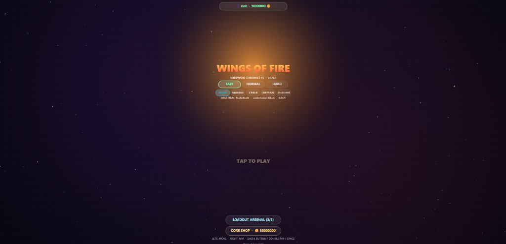
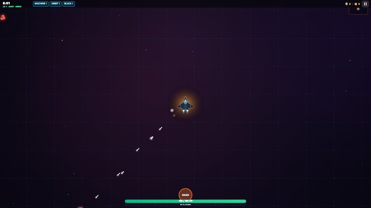
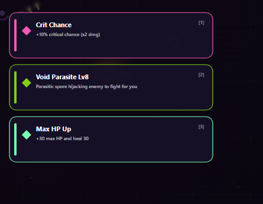

# 🔥 Wings of Fire: Survivor Chronicles

<p align="center">
  
</p>

<p align="center">
  <a href="https://wingsoffire.surge.sh"></a>
  <a href="LICENSE"></a>
  
  
  
</p>

---

## ⚡ Overview

**Wings of Fire: Survivor Chronicles** is a high-octane 2D top-down sci-fi roguelite bullet-heaven survival game built from the ground up with **zero external libraries, engines, or runtime frameworks**. 

Pilot a high-performance supersonic stealth fighter jet against relentless swarms of hostile alien armadas, evolving your arsenal across 20 distinct weapon classes, 3-tier branch evolution trees, and 5 lethal planetary biomes.

### 🕹️ [Play Directly in Browser (Live CDN)](https://wingsoffire.surge.sh)

---

## 📸 In-Game Screenshots

| In-Game Dogfight & Boss AI | Tactical Upgrade & Evolution Select |
|:---:|:---:|
|  |  |

---

## 🚀 Key Features

- **✈️ Supersonic Stealth Fighter**:
  - Precision delta-wing flight physics with dynamic 360° banking and dual plasma afterburner plumes.
  - Kinetic Shield Generator that dynamically absorbs impacts before hull compromise.
  - Tactical omnidirectional Dash boost with dedicated cooldown telemetry.

- **⚔️ 20 Upgradeable Weapons & Evolutions**:
  - **Arsenal:** Pulse Machine Gun, Twin Laser, Swarm Drone Bay, Void Singularity, EMP Shockwave, Hellfire Missiles, Orbiting Blades, Acid Spores, Gauss Railgun, Chrono Mine, and more.
  - **Color-Coded Progression Cards:** Cyan/Blue for Weapon Upgrades, Gold/Yellow for Passive Skills, Violet/Magenta for Evolutions, Emerald for Ship Repairs.

- **🪐 5 Cosmic Biomes**:
  - **Neon Deep Space**: Crisp starfield with cosmic dust nebulae.
  - **Magma Caverns**: Heat distortion shimmer, molten lava vents, and ember particles.
  - **Cyber Matrix**: Digital grid lines, cascading scanlines, and neon circuitry.
  - **Abyssal Trench**: Deep bioluminescent trench currents and benthic particles.
  - **Chrono Rift**: Spacetime distortion ripples, inverted chromatic fields, and temporal flux.

- **👾 Intelligent Hostile Fleet & Flagship Bosses**:
  - 5 Boss Flagships featuring dynamic phase transformations, aggressive pursuit algorithms, lethal ram dashes, and targeted high-intensity death-ray cannons.
  - Viewport-aware hostile entry mechanics: off-screen interceptors throttle at 2.6x cruise speed before locking onto the dogfight.
  - Clear visual threat hierarchy: Crimson red enemy ordnance, distinct orange/violet/magenta hostile hulls, and zero near-white clutter.

- **🎛️ Modern Cockpit HUD & Telemetry**:
  - **Bottom Dock:** Anchored 100/100 HP hull integrity gauge, kinetic shield barrier indicator, XP progression bar, and docked Boss HP status.
  - **Top Tactical Status:** Compact status pills displaying active weapon loadouts, upgrade tiers, passive perks, and temporary combat boosts.
  - **Bottom-Right Dash Trigger:** Accessible corner placement optimized for thumb ergonomics on mobile and tactile mouse navigation on desktop.

- **🔊 Procedural Synthesizer Audio**:
  - 100% procedural sound design powered by the native Web Audio API (chords, laser pings, explosion rumble, boss alarms, shield hum). Zero external audio asset loading.

- **📱 Dual Cross-Platform Controls**:
  - **Desktop (Mouse & Keyboard):** `W` `A` `S` `D` / Arrow keys for flight thrust, mouse cursor for 360° directional aiming, `Space` / `Right-Click` for tactical Dash.
  - **Mobile & Touch:** Dual virtual thumbsticks (Left: Propulsion, Right: Turret Aim) + Dedicated Bottom-Right Dash button.
  - **Native Android APK:** Standalone WebView wrapper with hardware acceleration and immersive fullscreen mode.

- **💾 Cloud & Local Persistence**:
  - Dual-currency meta-progression (in-run Scrap/Gold + persistent Core Coins).
  - LocalStorage + IndexedDB with optional Cloudflare sync API.

---

## 📂 Architecture & Codebase Structure

The game engine is segregated into **13 modular, focused ES6 modules** under `src/`:

```
Wings of Fire/
├── src/
│   ├── core/
│   │   ├── constants.js       # Game constants, weapon definitions, biomes, and color palettes
│   │   ├── audio.js           # Procedural Web Audio API sound synthesizer
│   │   └── storage.js         # Cloud sync, IndexedDB, local storage, profile persistence
│   ├── entities/
│   │   ├── player.js          # Player physics, health, XP leveling, shield & hitbox
│   │   ├── weapons.js         # 20 weapons attack logic, projectile physics, evolution trees
│   │   └── enemies.js         # Hostile fleet archetypes, Boss AI, ram charges, laser canons
│   ├── world/
│   │   └── world.js           # Biome generators, dynamic background effects, particle stars
│   ├── render/
│   │   ├── renderer.js        # Main rendering loop, camera tracking, floating text
│   │   └── vfx.js             # Supersonic jet renderer, boss models, shields, lasers, VFX
│   ├── ui/
│   │   ├── hud.js             # Bottom cockpit health dock, top upgrade pills, boss health
│   │   └── screens.js         # Main menu, biome selector, loadout arsenal, pause & game over
│   ├── input/
│   │   └── input.js           # Keyboard, mouse, and dual virtual touch joystick input
│   ├── css/
│   │   └── style.css          # Glassmorphic cyberpunk styling & responsive canvas wrapper
│   ├── favicon.ico            # Vector & raster game icon
│   ├── index.template.html    # Base HTML template for bundle builder
│   └── main.js                # Engine bootstrapping & 60 FPS requestAnimationFrame loop
├── app/                       # Android Studio Project (Native WebView APK Wrapper)
│   ├── build.gradle
│   └── src/main/java/com/wingsoffire/game/MainActivity.java
├── dist/                      # Web Production Distribution
│   ├── index.html             # Single-file production bundle (266 KB)
│   ├── 200.html               # SPA fallback for static hosts
│   ├── favicon.ico            # Favicon asset
│   └── CNAME                  # Custom domain configuration
├── docs/                      # Screenshots and documentation assets
├── build.js                   # Node.js bundler and automated Surge deployment pipeline
├── build.gradle               # Root Android Gradle configuration
├── gradlew.bat                # Gradle build script for Windows
├── LICENSE                    # MIT License
└── README.md                  # Project documentation
```

---

## 🛠️ Development & Build Pipeline

### Prerequisites
- [Node.js](https://nodejs.org/) (v16 or higher)
- Modern Web Browser (Chrome, Firefox, Safari, Edge)

### 1. Running Locally
Simply open `dist/index.html` in any browser, or run a local static server:
```bash
# Option A: Open directly
start dist/index.html

# Option B: Run via npx serve
npx serve dist
```

### 2. Building the Project
The build pipeline compiles all 13 modules into optimized, single-file bundles:
```bash
node build.js
```
The script performs:
1. Syntax validation across all 13 ES modules.
2. Inlines styles, scripts, and favicon into `dist/index.html`.
3. Synchronizes assets with `app/src/main/assets/index.html` for Android.

### 3. Deploying to Surge CDN
```bash
node build.js --deploy
```

### 4. Building the Android APK
```bash
# Debug APK Build
./gradlew assembleDebug

# Windows Command Prompt / PowerShell
.\gradlew.bat assembleDebug
```
The generated APK will be located at `app/build/outputs/apk/debug/app-debug.apk`.

---

## 🎮 Controls Reference

| Action | Desktop (Keyboard & Mouse) | Mobile / Tablet (Touch) |
|---|---|---|
| **Ship Movement** | `W` `A` `S` `D` or Arrow Keys | Left Virtual Joystick |
| **Aim Direction** | Mouse Cursor Pointer | Right Virtual Joystick |
| **Tactical Dash** | `Spacebar` / `Right Mouse Click` | Dedicated Bottom-Right DASH Button |
| **Fire Weapons** | Automatic Autofire System | Automatic Autofire System |
| **Pause / Resume** | `Escape` / `P` | Pause Button (Top-Right) |

---

## 📜 License & Changelog

- **License:** Licensed under the **MIT License** — see the [LICENSE](LICENSE) file for details.
- **Release History:** For full architectural updates, balancing passes, and release history, see [CHANGELOG.md](CHANGELOG.md).

---

<p align="center">
  Crafted with ❤️ by <a href="https://github.com/DevRush94">DevRush94</a>
</p>

